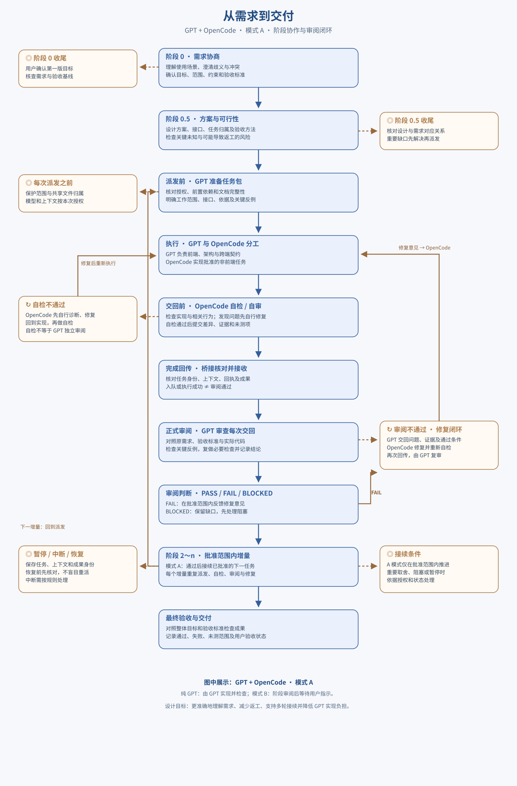

# Phase Workflow

**让 AI 协作从“完成一次对话”，走向“交付一个可检查的项目”。**

需求有据可查 · 任务边界清晰 · 实现与审阅分工 · 中断后保留状态

Codex × OpenCode &nbsp;·&nbsp; 分阶段协作 &nbsp;·&nbsp; 本机桥接

---

项目一旦跨越多次对话，需求容易被遗漏，任务交接需要反复解释，模型报告“完成”也不一定意味着功能经过验证。Phase Workflow 将需求、设计、执行和审阅串成一条可追溯的工作线，帮助你在每个检查点看清：**做了什么、依据是什么、还有什么没有验证。**

## 它解决什么问题？

| 常见困扰 | Phase Workflow 的做法 |
| --- | --- |
| 做到一半忘记最初要解决什么 | 先整理目标、范围和验收标准，后续按项目实际变化更新。 |
| 换模型或接续项目时反复搬运上下文 | 为每轮任务整理有效需求、约束、相关文件和上次审阅意见。 |
| 实现者说测试通过，就不知道能否放心使用 | Codex 根据原始要求、实际改动和必要证据审阅，区分执行成功、技术通过和用户验收。 |
| 中断或暂停后不清楚能否继续 | 桥接记录任务身份、上下文和状态；恢复时先核对，避免把不确定结果直接当作新任务重发。 |

## 如何协作

流程中的澄清、关键反例和独立审阅旨在减少需求偏差与返工；把批准的非前端实现交给 OpenCode 旨在减少 Codex 的实现负担。**这些是设计目标，目前尚无对照证据证明一定降低返工或节省 GPT 额度。** 持久化状态支持中断后核对与接续，不等于已经验证长时间无人值守稳定运行。

- **Codex** 负责需求协商、方案、前端设计与实现，以及对 OpenCode 成果的技术审阅。
- **OpenCode** 在用户批准的范围内承担非前端实现与自检，交回实际改动、检查结果和已知缺口。
- **本机桥接** 负责派发、回传与状态衔接；任务结束后，仍需根据验收标准审阅。

推进方式可按项目选择：**A 模式**在批准范围内自动接续；**B 模式**在约定阶段审阅后等待用户决定。内部可以按需要小步实现，交接检查点以可观察成果为准，不必为每次提交停下来。

## 性能与验证情况

该系统的目的是让协作过程更清楚、更容易检查；实际收益取决于任务规模、模型表现和审阅成本。

当前主仓库的桥接 **1.3.2** 记录了以下检查：

| 检查 | 记录结果 | 范围 |
| --- | --- | --- |
| 桥接回归 | 113 项通过 | 合成状态与模拟服务，不代表真实项目端到端通过 |
| 安装版针对性检查 | 17 项通过 | 隔离环境，覆盖暂停审阅登记与恢复 |
| 新建隔离 MCP 进程 | 协议和版本检查通过 | 未调用真实模型或运行真实任务 |

1.3.2 的真实模型端到端、长期无人值守以及操作系统重启后的恢复仍未验证。已有宿主进程可能缓存旧版工具；实际使用前应核对桥接版本和工具接口。完整结果见 [桥接 1.3.2 检查记录](docs/bridge-1.3.2-review.md)。

## 适合谁

**适合**需要跨多轮对话推进、希望保留需求和验收依据，或需要多个 AI 工具协作的软件项目。

**不一定适合**一次性问答和边界清楚的小修改：这些任务直接处理可能更简单。项目涉及真实账户、数据或外部服务时，仍需由使用者确认授权与实际验证范围。

## 从哪里开始

本仓库当前包含工作流规则和桥接源码；不同版本的源码、安装状态和验证结论应分别看待。

| 内容 | 入口 |
| --- | --- |
| 阶段工作流、分工和 A/B 推进规则 | [project-phase-workflow 技能](skills/project-phase-workflow/SKILL.md) |
| 4.2.6 测试边界改动和另一台电脑的安装步骤 | [测试边界设计与复刻指南](docs/skill-4.2.6-testing-design.md) |
| 本机桥接实现 | [phase_bridge.py](bridge/phase_bridge.py) |
| 1.3.2 变更、检查结果及限制 | [桥接检查记录](docs/bridge-1.3.2-review.md) |

配置模型、项目可写目录和外发范围时，需要根据自己的环境单独确认。安装工具本身不等于授权执行项目任务。

---

